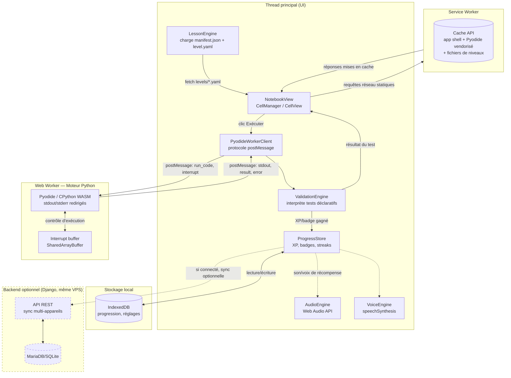

# Schéma d'architecture

## Points notables

- **`PyodideWorkerClient` ↔ Worker** est la seule frontière qui parle à Python : aucun code
  utilisateur ne s'exécute jamais sur le thread principal (isolation + UI jamais bloquée).
- **`ValidationEngine`** vit côté thread principal, pas dans le worker : il reçoit stdout/valeurs
  de variables déjà extraites par Pyodide et les compare aux `tests` déclarés dans le niveau — ça
  garde le moteur de validation agnostique du contenu (plug-in sans toucher au code).
- Le **Backend Django** est en pointillé dans le diagramme d'origine (optionnel), mais est
  maintenant confirmé comme faisant partie du périmètre du projet — branché uniquement sur
  `ProgressStore`, jamais une dépendance du parcours d'apprentissage.
